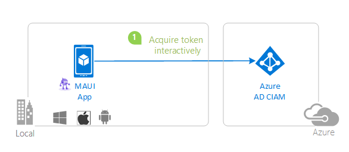

# A .NET MAUI Blazor Hybrid app using MSAL.NET with Microsoft Entra ID workforce tenants

## Overview

This sample demonstrates a **4-project Blazor solution** for a standard Microsoft Entra ID workforce (internal/corporate) tenant. It runs the same shared UI in a native .NET MAUI Blazor Hybrid app and in a Blazor Web App across every Blazor render mode. It targets **.NET 10**.

| Project | Description |
|---|---|
| **SignInBlazorMauiWorkforce** | .NET MAUI Blazor Hybrid app for iOS, Android, Mac Catalyst, and Windows. Uses MSAL.NET for native sign-in. |
| **SignInBlazorMauiWorkforce.Shared** | Razor Class Library containing the shared UI, claims page, layout, and services. |
| **SignInBlazorMauiWorkforce.Web** | ASP.NET Core Blazor Web App using Microsoft.Identity.Web for OpenID Connect. It hosts every render mode and exposes a protected `/api/weather` endpoint. |
| **SignInBlazorMauiWorkforce.Web.Client** | Blazor WebAssembly client for Interactive WebAssembly and Interactive Auto. It receives serialized authentication state and stores no tokens. |

> This is a workforce sample. It is for accounts in your organization, not Microsoft Entra External ID/CIAM customer identities or personal Microsoft accounts.

## Scenario

1. The MAUI app uses MSAL.NET to sign in a work or school user and acquire an access token for the protected sample API.
1. The web app uses OpenID Connect and a cookie to sign in browser users from the same workforce tenant.
1. Both hosts reuse the shared components, including the Account claims page and Weather page with its refresh action.



## Prerequisites

* [Visual Studio 2022 17.14+](https://aka.ms/vsdownload), or the [.NET 10 SDK](https://dotnet.microsoft.com/download/dotnet/10.0) with the **MAUI** and **wasm-tools** workloads.
* A Microsoft Entra ID workforce tenant and a work or school user in that tenant.
* Permission to create app registrations in the tenant. The automated setup also needs consent for Microsoft Graph `Application.ReadWrite.All` and `Organization.Read.All`.

## Setup

Clone the repository, then open this sample:

```console
cd 1-Authentication/6-sign-in-blazor-maui-workforce
```

The sample uses two **single-tenant** app registrations:

* `workforce-dotnet-blazor-maui-web`: confidential web app and protected API.
* `workforce-dotnet-blazor-maui`: public native client.

The WebAssembly client has no registration because the server serializes the authenticated state to it and it never receives an access token.

### Automated registration

Install PowerShell 7 and run:

```powershell
cd AppCreationScripts
./Configure.ps1 -TenantId "contoso.onmicrosoft.com"
```

The script creates both registrations with the **Accounts in this organizational directory only** audience, configures the web redirect URI and the MAUI public-client redirect URIs, exposes `api://{web-app-id}/access_as_user`, creates a web client secret, grants the MAUI client the delegated scope, and updates only this sample's placeholder files. See [AppCreationScripts.md](./AppCreationScripts/AppCreationScripts.md) for cleanup and sovereign-cloud options.

### Manual registration

#### Register the web/API application

1. In the [Microsoft Entra admin center](https://entra.microsoft.com/), open **App registrations** and create `workforce-dotnet-blazor-maui-web`.
1. Select **Accounts in this organizational directory only**.
1. Under **Authentication**, add the **Web** redirect URI `https://localhost:7157/signin-oidc`. This application uses the authorization code flow; do not enable implicit grant ID tokens.
1. Under **Certificates & secrets**, create a client secret and copy its **value**.
1. Under **Expose an API**, set Application ID URI to `api://{web-app-id}` and add the delegated `access_as_user` scope.
1. Replace `TenantId`, `ClientId`, and `ClientSecret` in `SignInBlazorMauiWorkforce.Web/appsettings.json`.

#### Register the MAUI application

1. Create `workforce-dotnet-blazor-maui` with **Accounts in this organizational directory only**.
1. Under **Authentication**, enable **Allow public client flows**. Add the **Mobile and desktop applications** redirect URIs `msal{maui-app-id}://auth` and `http://localhost`.
1. Under **API permissions**, add the web/API application's delegated `access_as_user` permission. Grant tenant-wide consent if your organization requires administrator consent.
1. Replace the MAUI `Authority`, `ClientId`, and API scope placeholders in `SignInBlazorMauiWorkforce/appsettings.json`. The authority format is `https://login.microsoftonline.com/{tenant-id}`.
1. Replace `Enter_the_Application_Id_Here` in the Android manifest and iOS and Mac Catalyst Info.plist files with the MAUI application ID so their `msal{client-id}://auth` redirects match the registration.

## Run the sample

Run the web app:

```console
cd SignInBlazorMauiWorkforce.Web
dotnet run
```

Open `https://localhost:7157`, then sign in with a user from the configured workforce tenant.

Run the MAUI app by selecting a platform startup target in Visual Studio, rebuilding the solution, and starting it. The native MSAL flow uses platform-appropriate UI: a system browser sheet on iOS and Mac Catalyst, a Chrome Custom Tab on Android, and Windows desktop authentication on Windows.

## Explore the sample

The web host demonstrates:

| Page | Route | Render mode |
|---|---|---|
| Home | `/` | Static SSR |
| Counter | `/counter` | Interactive Server |
| Weather | `/weather` | Interactive WebAssembly |
| Account | `/account` | Interactive Auto |

The protected Weather endpoint accepts both the browser authentication cookie and the MAUI bearer token. The Account page displays the claims available from the local authentication state. Interactive WebAssembly and Auto receive serialized claims only; no browser access token is stored.

The MAUI app hosts the same components in a `BlazorWebView`. On .NET 10, `InteractiveRenderSettings.ConfigureBlazorHybridRenderModes()` clears the per-page render modes because a `BlazorWebView` is already interactive and rejects explicit render modes. The web host retains the real render modes. This workaround is no longer needed in .NET 11.

MSAL stores its iOS cache in the app's private Keychain group. Mac Catalyst uses the same app-private group through `SecureStorage`, retaining durable secure cache behavior without cross-app `com.microsoft.adalcache` sharing.

## Troubleshooting

* **AADSTS50020 or wrong account**: verify that the registration is single-tenant and sign in with an account from the configured directory.
* **AADSTS50011**: add the exact redirect URI shown in the error to the matching app registration.
* **Consent required**: grant tenant administrator consent for the delegated API permission if user consent is restricted.
* **Projects do not load**: install the .NET MAUI workload in Visual Studio or with the .NET SDK.

## Learn more

* [Microsoft Entra ID application registration](https://learn.microsoft.com/entra/identity-platform/quickstart-register-app)
* [Microsoft identity platform OpenID Connect protocol](https://learn.microsoft.com/entra/identity-platform/v2-protocols-oidc)
* [MSAL.NET desktop and mobile applications](https://learn.microsoft.com/entra/msal/dotnet/acquiring-tokens/desktop-mobile/acquiring-tokens-interactively)
* [Microsoft.Identity.Web](https://learn.microsoft.com/entra/identity-platform/microsoft-identity-web)
* [Blazor Hybrid](https://learn.microsoft.com/aspnet/core/blazor/hybrid/)
